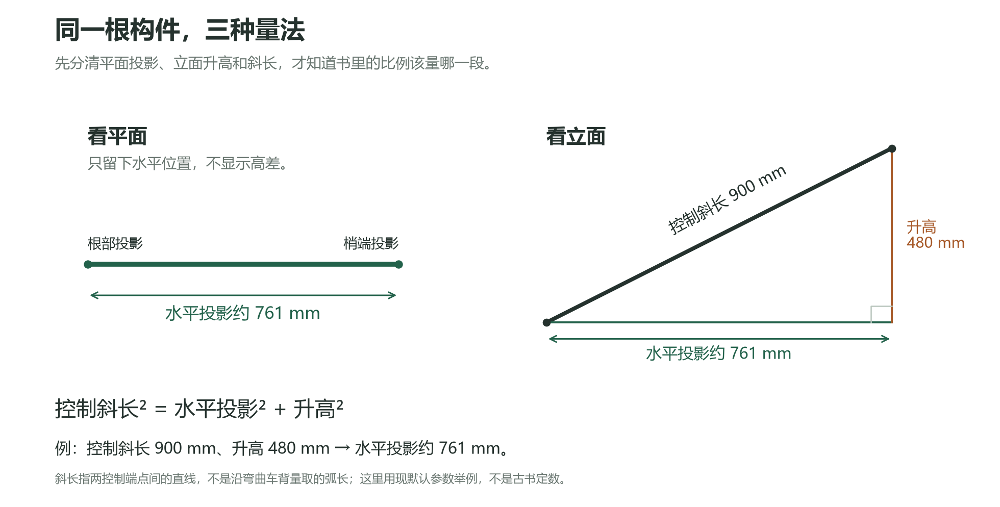
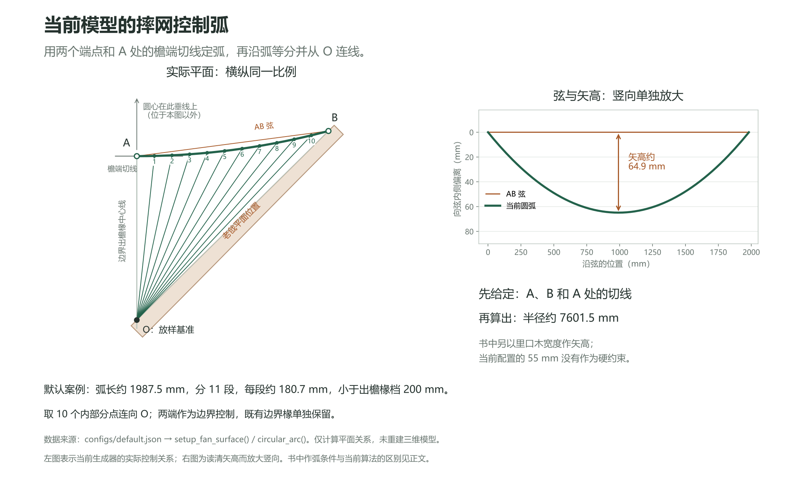

# 从书中做法到生成公式

核对日期：2026-10-29  
适用范围：生成器“直角戗角”v0.3 的几何取舍说明，面向学习古建筑构造与放样的读者。

## 先说结论

生成器不是把古书中的一句话直接变成唯一答案。它先把书中的构件关系和放样步骤读出来，再把能量取的长度、角度和先后关系写成几何约束；书上没有定下的细节，则明确作为本项目的可变假设或现代建模办法。

阅读下文时，请留意三种依据：

- **书中明确：**所核页图或文字确实表达了这个尺寸关系、构件次序或放样步骤。
- **本项目的解释：**原文留下了多种读法，本项目选择一种能稳定生成模型的解释；这不是古书明定的唯一算法。
- **本项目补充：**书中未给出现成数值或算法，为生成器计算、绘图和排料而增加的选择。

这里所说的“古书依据”主要来自《图解〈营造法原〉做法》第五章。该书在介绍《营造法原》时也补充了构造做法和图解步骤，因此不把《图解》的说明一概说成姚承祖原书原文。《营造法原》原书的图版十七另行标出。

## 1. 先认清构件和量的方向

**老戗**、**嫩戗**是角部两根主要斜向构件。可以先把它们理解为戗角骨架的两条主线：老戗从角部向外挑，嫩戗从较低处接向较高的角部。书里的长度和角度必须连同“平面”或“立面”来读。

**出檐椽**是正身檐口处的普通椽；**摔网椽**是转角扇面中按放样分位布置的椽。**里口木**收住檐口内侧的弧形边界，日常说法可理解为摔网椽、飞椽根部附近的一道弯木。**望板**是铺在椽上承托屋面的板层。

**立脚飞椽**是角部向外挑出的飞椽。书中讨论了它的侧立面形状和逐根厚度变化；本项目还要为每根飞椽计算与里口、望板相接的几何位置。这里的“根厚”“梢厚”是构件截面量，不等于平面上两根椽之间的距离。

### 平面内角与立面夹角

本生成器的角度参数表示平面图中两条檐桁轴线从屋角向屋内延伸时的夹角，记作 α。90°只是默认配置。非90°时，程序按实际夹角重建两翼的对称骨架。

《图解》印刷页116（PDF001第127页）以及《营造法原》图版十七提到的约130°至122°，说的是老戗与嫩戗在立面上的“落水”角。它和本项目的平面内角 α 不是同一个量，不能把这组角度直接填进 α。图版十七旁边的寸分字样在扫描中不够清楚，也不据此反推平面尺寸。

[查看矢量版](assets/平面立面与实长.svg)。此图用当前默认输入举例，只说明平面投影、竖向升高和斜向实长之间的关系；不是古书原图，也不代表某座建筑的实测尺寸。

## 2. 书中尺寸怎样变成可计算的长度

### 营造尺和尺寸例子

《图解》前言说明，本书所用营造尺中，1尺合27.5厘米，1寸合2.75厘米，也就是1寸合27.5毫米。这是书中采用的换算标尺；换算后再用毫米计算，不会改变原来的比例。

例如，按这把尺，2寸为55毫米。当前配置里的里口木平面宽度也取55毫米。两者数值相同，并不表示当前生成器的所有弧线都按古书“2寸作矢高”的步骤画成。

书中给出过特定放样例子：界深D取1200毫米、檐出取600毫米、正身飞椽水平外挑取300毫米，放叉系数按0.9取值。于是该例的放叉量为：

> **算式：**300 × 0.9 = 270毫米

这说明怎样从一个选定系数算出该例的放叉量，不是所有建筑都必须采用的统一比例。书中还举有“四六式”等尺寸安排；它是可参考的一种制度，不是把各种建筑都限定成同一组尺寸。

### 平面投影、高差和斜长

书中的嫩戗长度关系要分清三个方向：

- **平面投影**：从上方看，构件在水平面里走了多远。
- **竖向升高**：构件两端在高度上差多少。
- **斜长**：沿构件本身量取的实际长度。

如果已知水平投影H和升高V，直角三角形给出斜长L：

> **几何关系：**L = √（H² + V²）

《图解》印刷页115（PDF001第126页）的构造示例用水平距离与提栈高差组成直角三角形，按斜边取戗木实长。古建筑木料的实际量取还须确认起点、终点与量向；公式本身不会替我们决定这些端点。

当前生成器的一个示例采用嫩戗两控制端点间的直线斜长（空间控制弦长）900毫米、相对升高480毫米。900毫米量的是两端点间直线，不是沿弯曲车背表面量出的弧长。900和480是本项目当前默认输入，不是书中原尺寸。原书所说的“嫩戗长”端点与量法未在所核页完全定明；本项目这个控制弦假设不替原书消除该问题。因为这里给出的是直线斜长和升高，平面投影反算为：

> **当前示例：**√（900² − 480²）≈ 761.3毫米

这就是教学图中约761毫米的来源。书中常见的“平面长度加高差求实长”和当前的“给实长、高差求平面投影”，只是同一个直角三角形的正算与反算。

## 3. 从扇形放样到摔网椽分档

书中在印刷页122–124（PDF001第133–135页，图5-2-21至27）讲平面放样。印刷页123（PDF001第134页，图5-2-22至24）是分椽理解的关键页：先确定弯曲边线，再把弧线等分，以出檐椽中心线和戗边的交点作基准，连接基准点与弧上的分位点，得到摔网椽的分位线。书中还说明弧的等分数取单数，并要求等分距离A小于普通出檐椽档B。

这段话告诉我们“从哪里连到哪里”，但没有替每种建筑给出固定的根数，也没有在所核页上说明A应量弧长、弦长还是水平投影。因此要生成可重复的根数，还得公开本项目的读法：

1. 把“单数”解释为弧线被分成的区间数n为奇数。
2. 本项目选满足弧长÷n小于普通出檐椽中心距B的最小奇数n。
3. 取相邻区间之间的内部分界点，也就是从头量到全弧的1/n、2/n，直至(n−1)/n处；两端作为边界，不再重复造椽。不是在每个区间中间另取一点。
4. 从书图所示的基准点O连向各内部点，生成内部摔网椽中心线。

简化写成：

> **项目分档：**A = 弧长 ÷ n，并选最小奇数n使A < B  
> **内部线数：**n − 1

n表示弧段数，n−1表示内部摔网椽分位线数。它不是书中明定的“总椽根数”。普通边界出檐椽仍保留，端点共轴时只计一次。

[查看矢量版](assets/弧等分与摔网椽.svg)。图的左侧按当前默认配置的实际平面坐标等比例绘制，弧分为11段，取10个内部分点；这组根数来自本项目的参数和端点处理，并非书中定数。图上的O是放样连线的基准点，不是画弧的圆心。右侧单独放大了弧相对于弦的偏离，以便看清矢高，不能用右图量取角度。

此前此处的教学图用了任意圆弧，只能演示“分点后连线”，却配上了实际构件的名称，容易把弧的方向、深浅和边界关系理解错。现已改用程序计算出的控制弧。

### 书中的弧矢高和当前模型的弧

书中印刷页122（PDF001第133页）的步骤描述了用指定弦线和里口木宽度作矢高，再画弧线的放样方法。这是书中图解的具体做法。

当前生成器采用另一种简化：先给定平面弧的两个端点，再规定弧端与正身檐端线相切，由这两个端点和切线确定圆弧。弧的矢高、半径和长度是计算结果，不再另把55毫米里口宽度设成固定矢高。这样做是本项目选择的曲线构造条件，不能写成书中原步骤的直接照搬。

**这条弧具体怎样画？** 先把普通边界出檐椽的檐端记为A，把老戗近侧的控制点记为B，连接AB作为弦。程序要求A处的圆弧与正身檐端线相切，因此圆心必在“经过A、垂直于正身檐端线”的直线上。再作AB的垂直平分线，两线的交点就是圆心；以圆心到A的距离为半径，从A画到B。这和放射椽位的基准点O是两套不同的几何关系。

用简单算式表达：令A为局部起点，沿正身檐端线量到B的距离为横向差Δx，垂直于这条檐端线量到B的距离为纵向差Δy，则：

> **当前切线作弧：**半径R =（Δx² + Δy²）÷（2 × Δy）

这两个差值都是平面距离，Δy不是立面升高。当前默认配置算得Δx约1965.0毫米、Δy约258.4毫米，因此R约7601.5毫米。AB弦长约1981.9毫米，对应弦矢高约64.9毫米，弧长约1987.5毫米。它应是一条浅弧，而非前图那样拱起很高的弧。

**若照书中的“弦＋矢高”画法：**设弦长为L，里口木宽度作为矢高f，则半径为：

> **弦矢高作弧：**半径R = L² ÷（8 × f）+ f ÷ 2

这时矢高是先给定的，端部切线随后由圆弧决定；当前程序则先给定端部切线，再算出矢高。两者通常不能同时强定为同一个结果。默认配置算出的64.9毫米不等于里口木宽55毫米，正好说明当前模型并未直接实现书中这一步的全部作弧条件。图书依据见[印刷页122／PDF第133页](../../../资料整理/阅图/PDF001/PDF001_p133.png)，程序实现见[圆弧函数](../engine/stage02_core.py#L378)。

弧线形状会影响弧长与椽位。本项目据弧长分档；这是计算约定，原书没有限定A的量法。

## 4. 侧立面厚度规则如何转成构件

《图解》印刷页120（PDF001第131页，图5-2-18）给出立脚飞椽侧立面的形态与厚度关系：上小下大；梢头厚度同直挺飞椽；根部厚度从直挺飞椽一侧逐根增加；靠近嫩戗的第一根达到嫩戗厚度的六至七折。这里的厚度解释为平行四边形的高。

用比例写出原书范围，可记作：

> **书中关系：**近嫩戗一侧的目标根厚 ≈ 嫩戗厚 × 0.6至0.7

原书没有规定从第一根到最后一根怎样逐根插值，也没有把厚度方向说成全局竖直或某个曲面法向。本项目把0.65作为六至七折之间的可调取值，并在中间各根之间作平滑过渡；0.65是项目参数，不是古书给定的精确比例。

这条规则只决定一组根厚关系，不能单独决定每根上缘的半径、弯曲程度和尾端长度。当前构件还要按它所处位置与支承边界计算；书上没有逐根给出当前模型所用的全部端点和切线条件。

### 嫩戗背的弯势不是单根飞椽弧度

《图解》印刷页129（PDF001第140页，图5-2-38、39）说嫩戗背的弯势矢高约为嫩戗长度的0.10至0.15。比例的对象是嫩戗背，基准是嫩戗长度；不是一根飞椽的弦长，也不是所有飞椽都要有同一个0.125倍弦长弯高。

当前生成器中的嫩戗车背由截面几何派生，没有把0.125×构件长度作为独立硬输入。其他组合木背弧或单根飞椽轮廓，均须按各自的几何边界理解，不能把书中嫩戗比例移用过去。

## 5. 从构造关系到现代几何模型

书中提供构件名称、尺寸关系、平面放样步骤和部分立面形态；当前三维几何还需要一套连续、可重复的计算办法。以下是本项目为此作的现代建模选择。

### 共同虚拟母板

生成器先建立一张覆盖飞椽和椽间空隙的连续虚拟曲面，再用每根椽两侧的竖直边界面，从这张曲面上取出对应的材料范围。可把它理解成先有一张供计算的连续样板，再按椽宽划分；这张“母板”是数学上的共同基准，不是建筑里另外加做的一层木板，也不能据此断言历史匠人实际使用过同样的样板。

飞椽的边界和底面由共同曲面派生。里口承口也沿对应的分椽边界与曲面底面求取，使飞椽和承口在模型中使用同一个几何来源。这是避免各构件各自估一条边、最后互相错开的建模办法，不是古书明文给出的加工工序。

上层卷戗板在当前模型中每翼作为一件连续板生成；旧的窄条拼接办法已经不代表本版构造。连续一件是当前建模约定，不能反说书中规定了现代模型里的实体拓扑。

### 尖尾由相接关系确定

《图解》印刷页124（PDF001第135页）在飞椽放样部分提到尾长不应短于飞椽外挑长度的1.5倍。这是书中有依据的一条传统尺寸要求。当前项目没有将1.5倍设置成必须达到的三维目标，也没有额外抬高20毫米支点来凑出该比例。

本模型沿构件的实际边界关系求出尖尾落到望板的位置，尾长是求交后的结果。这样做把“尾端要落在什么构件上”作为几何关系，把书中尾长比例作为读书时应知的来源信息；它不表示本模型已经证明传统尾长要求不重要，也不表示模型通过了木作可施工性验收。

## 6. 排料是本项目的分析图，不是古书锯料规程

当前排料图只取一侧立脚飞椽的中心截面，把它简化成梯形后排布两套板料。图上AD、BC作为竖直边，各梯形的A点落在同一底线上，再依次靠紧。b、c、d分别用各自的曲线表示边界；将c看作d平移后的曲线，只用于比较诊断。它服务于当前的材料排布研究，不是从古书中还原出的传统锯料法，也不等于三维飞椽全宽表面的精确展开。

排料图里的顶点A、B、C、D是本项目自己的截面标记；不要和书图中的A、B混淆。书图的A是弧线分档距离，B是普通出檐椽档。排料中b、c、d的样条和平移误差是现代计算比较；其中c由d平移得到只是一种诊断近似，误差不约束三维模型，也不会因为排料误差较小就自动证明木料能按古法加工。

## 7. 读书、读模型时可带走的判断

| 问题 | 书中能支持什么 | 当前模型多做了什么 |
| --- | --- | --- |
| 如何安排扇形摔网椽 | 弧线等分、等分数取单数、A小于出檐椽档B，并由基准点连到弧上分位点 | 解释n为奇数区间数，按弧长等分，边界椽保留且去重 |
| 里口弧怎样画 | 图解页举了指定弦和里口宽度作矢高的办法 | 按弧端点和端切线确定当前平面圆弧 |
| 飞椽厚度怎样变 | 梢厚同直挺飞椽，根厚逐步增加，近嫩戗目标为嫩戗厚六至七折 | 取0.65为可调目标，并在中间根之间平滑过渡 |
| 嫩戗弯势比例是什么 | 嫩戗背矢高约为嫩戗长度的0.10至0.15 | 车背由本模型截面关系派生，不把比例当单根飞椽硬输入 |
| 另一翼怎样处理 | 本轮所引页没有给出可变平面夹角的三维算法 | 把平面内角α作为项目输入，按角平分面对称重建两翼 |
| 尖尾和排料怎么落地 | 图解给出传统尾长关系与平面放样示例 | 尾端按望板关系求交；中心截面梯形和样条用于现代排料分析 |

读书图时，要先辨明A、B、弧、角和“长度”所指的图、量向与构件类别。本项目的切线定弧、0.65根厚目标、对称非直角骨架、虚拟母板和梯形排料，都是明示且可复算的模型选择。

## 来源对照与页图

PDF001为侯洪德、侯肖琪《图解〈营造法原〉做法》，中国建筑工业出版社，2014年7月第一版第一次印刷。第五章本次引用范围的扫描PDF页序为印刷页码加11；这个偏移只适用于该段，不能套用于PDF002原书。PDF002是姚承祖《营造法原》扫描本，图版编号和页序另行核对。

| 依据主题 | 印刷页／PDF页序／图号 | 页图与核读记录 |
| --- | --- | --- |
| 营造尺换算 | 前言无印刷页／PDF001第7页 | [查看页图](../../../资料整理/阅图/PDF001/PDF001_p007.png) |
| 四六式及戗角尺寸关系 | 印刷114页／PDF001第125页／图5-2-1至4 | [查看页图](../../../资料整理/阅图/PDF001/PDF001_p125.png)；[核读问题清单](../../../资料整理/资料核读与问题清单.md) |
| 水平距离、提栈与斜长 | 印刷115页／PDF001第126页／图5-2-5至7 | [查看页图](../../../资料整理/阅图/PDF001/PDF001_p126.png) |
| 老、嫩戗落水角 | 印刷116页／PDF001第127页／图5-2-8至10 | [查看页图](../../../资料整理/阅图/PDF001/PDF001_p127.png) |
| 立脚飞椽侧面及厚度 | 印刷120页／PDF001第131页／图5-2-18 | [查看页图](../../../资料整理/阅图/PDF001/PDF001_p131.png)；[弧度比例核读](../../../资料整理/飞椽上缘弧度比例核读_2026-10-22.md) |
| 平面弧线放样 | 印刷122页／PDF001第133页／图5-2-21及相关步骤 | [查看页图](../../../资料整理/阅图/PDF001/PDF001_p133.png) |
| 弧线分档与摔网椽分位 | 印刷123页／PDF001第134页／图5-2-22至24 | [查看页图](../../../资料整理/阅图/PDF001/PDF001_p134.png)；[原页核读](../../../资料整理/边界出檐椽与摔网分档_2026-10-26.md) |
| 飞椽平面放样、尾长 | 印刷124页／PDF001第135页／图5-2-25至27 | [查看页图](../../../资料整理/阅图/PDF001/PDF001_p135.png) |
| 嫩戗背弯势矢高 | 印刷129页／PDF001第140页／图5-2-38、39 | [查看页图](../../../资料整理/阅图/PDF001/PDF001_p140.png)；[原页核读](../../../资料整理/飞椽上缘弧度比例核读_2026-10-22.md) |
| 原书图版十七 | 印刷189页／PDF002扫描第86页／“戗角木骨构造图” | [查看页图](../../../资料整理/阅图/PDF002/PDF002_p086.png)；[图版核读](../../../资料整理/原书核读记录.md) |

关于分椽、根厚和曲线对象的详细核读，可进一步查看[资料核读与问题清单](../../../资料整理/资料核读与问题清单.md)、[边界出檐椽与摔网分档](../../../资料整理/边界出檐椽与摔网分档_2026-10-26.md)、[飞椽上缘弧度比例核读](../../../资料整理/飞椽上缘弧度比例核读_2026-10-22.md)及[原书核读记录](../../../资料整理/原书核读记录.md)。

## 延伸阅读

- [生成原理与计算公式](生成原理与计算公式.md)：当前几何模型的坐标、参数、离散方法与计算式。
- [程序执行过程](程序执行过程.md)：从配置读取到生成阶段和结果输出的执行顺序。

