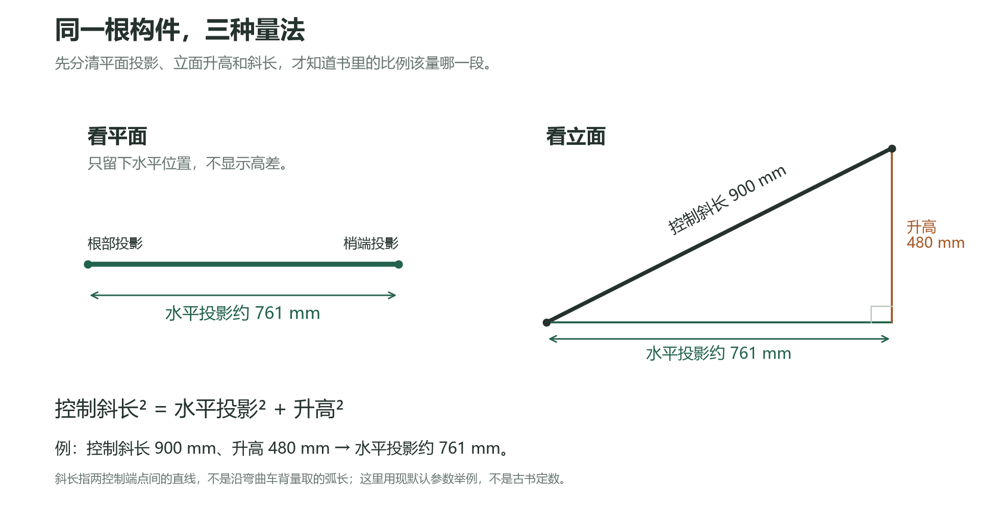
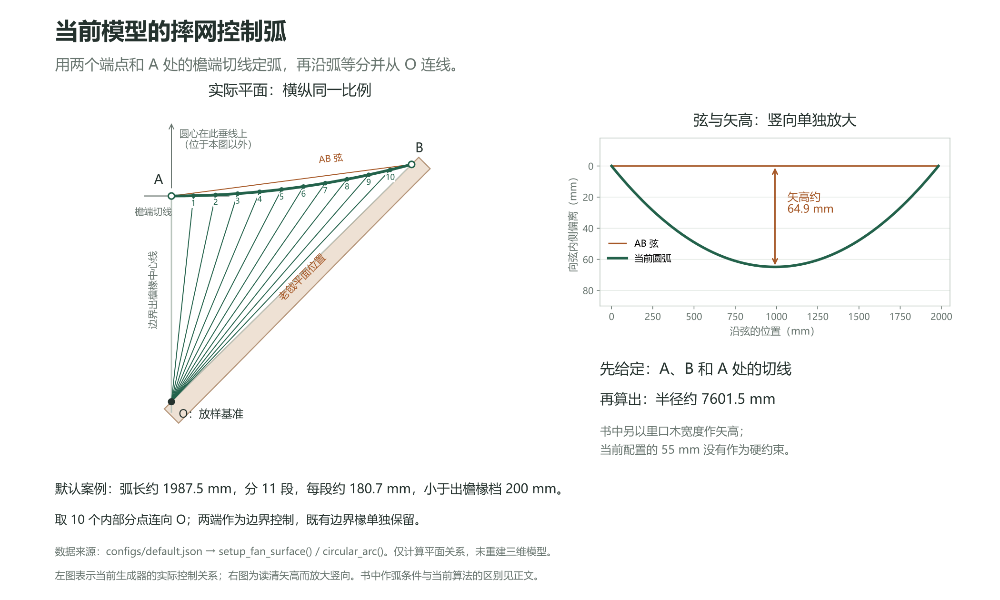

# 从书中做法到生成公式

核对日期：2026-10-29  
表达更新：2026-11-01  
适用范围：生成器“直角戗角”v0.4 的精确几何，面向学习古建筑构造与放样的读者。

本文区分**书中明确的关系**、**本项目对原文的解释**和**为计算补充的建模选择**。主要依据是侯洪德、侯肖琪《图解〈营造法原〉做法》（PDF001）；姚承祖《营造法原》（PDF002）原书图版十七单独引用。来源和页图列在文末。

## 1. 先认清构件和量的方向

**老戗**、**嫩戗**是角部两根主要斜向构件。可以先把它们理解为戗角骨架的两条主线：老戗从角部向外挑，嫩戗从较低处接向较高的角部。书里的长度和角度必须连同“平面”或“立面”来读。

**出檐椽**是正身檐口处的普通椽；**摔网椽**是转角扇面中按放样分位布置的椽。**里口木**收住檐口内侧的弧形边界，日常说法可理解为摔网椽、飞椽根部附近的一道弯木。**望板**是铺在椽上承托屋面的板层。

**立脚飞椽**是角部向外挑出的飞椽。书中讨论了它的侧立面形状和逐根厚度变化；本项目还要为每根飞椽计算与里口、望板相接的几何位置。“根厚”“梢厚”指构件截面量。

### 平面内角与立面夹角

本生成器的角度参数表示平面图中两条檐桁轴线从屋角向屋内延伸时的夹角，记作 α。90°只是默认配置。非90°时，程序按实际夹角重建两翼的对称骨架。

《图解》印刷页116（PDF001第127页）以及《营造法原》图版十七提到的约130°至122°，说的是老戗与嫩戗在立面上的“落水”角。本项目的 α 表示平面内角。图版十七旁的寸分字样在扫描中不够清楚，平面尺寸需另定。

[查看矢量版](assets/平面立面与实长.svg)。教学图以当前默认输入说明平面投影、竖向升高和斜向实长的关系。

## 2. 书中尺寸怎样变成可计算的长度

### 营造尺和尺寸例子

《图解》前言说明，本书所用营造尺中，1尺合27.5厘米，1寸合2.75厘米，也就是1寸合27.5毫米。这是书中采用的换算标尺；换算后以毫米计算。

例如，按这把尺，2寸为55毫米。当前配置里的里口木平面宽度也取55毫米。两者数值相同，并不表示当前生成器的所有弧线都按古书“2寸作矢高”的步骤画成。

书中给出过特定放样例子：界深D取1200毫米、檐出取600毫米、正身飞椽水平外挑取300毫米，放叉系数按0.9取值。于是该例的放叉量为：

> **算式：**300 × 0.9 = 270毫米

这个算例按选定系数求放叉量；书中还举有“四六式”等尺寸安排。

### 平面投影、高差和斜长

书中的嫩戗长度关系要分清三个方向：

- **平面投影**：从上方看，构件在水平面里走了多远。
- **竖向升高**：构件两端在高度上差多少。
- **斜长**：沿构件本身量取的实际长度。

如果已知水平投影H和升高V，直角三角形给出斜长L：

> **几何关系：**L = √（H² + V²）

《图解》印刷页115（PDF001第126页）的构造示例用水平距离与提栈高差组成直角三角形，按斜边取戗木实长。古建筑木料的实际量取还须确认起点、终点与量向；公式本身不会替我们决定这些端点。

当前默认输入将嫩戗两控制端点间的空间直线弦长设为900毫米、相对升高设为480毫米。所核页未完全定明原书“嫩戗长”的端点与量法；项目以控制弦作为建模假设，反算平面投影：

> **当前示例：**√（900² − 480²）≈ 761.3毫米

这就是教学图中约761毫米的来源。书中常见的“平面长度加高差求实长”和当前的“给实长、高差求平面投影”，只是同一个直角三角形的正算与反算。

## 3. 从扇形放样到摔网椽分档

书中在印刷页122–124（PDF001第133–135页，图5-2-21至27）讲平面放样。印刷页123（PDF001第134页，图5-2-22至24）是分椽理解的关键页：先确定弯曲边线，再把弧线等分，以出檐椽中心线和戗边的交点作基准，连接基准点与弧上的分位点，得到摔网椽的分位线。书中还说明弧的等分数取单数，并要求等分距离A小于普通出檐椽档B。

这段话告诉我们“从哪里连到哪里”，但没有替每种建筑给出固定的根数，也没有在所核页上说明A应量弧长、弦长还是水平投影。因此要生成可重复的根数，还得公开本项目的读法：

1. 把“单数”解释为弧线被分成的区间数n为奇数。
2. 本项目选满足弧长÷n小于普通出檐椽中心距B的最小奇数n。
3. 取相邻区间之间的内部分界点，也就是从头量到全弧的1/n、2/n，直至(n−1)/n处；两端作为边界。
4. 从书图所示的基准点O连向各内部点，生成内部摔网椽中心线。

简化写成：

> **项目分档：**A = 弧长 ÷ n，并选最小奇数n使A < B  
> **内部线数：**n − 1

n表示项目选定的弧段数，n−1表示内部摔网椽分位线数。普通边界出檐椽保留，端点共轴时只计一次。

[查看矢量版](assets/弧等分与摔网椽.svg)。图的左侧按当前默认配置的实际平面坐标等比例绘制，弧分为11段，取10个内部分点；根数由项目参数和端点处理确定。O是放样连线的基准点；右侧放大弧相对弦的偏离以显示矢高，角度以左图为准。

### 书中的弧矢高和当前模型的弧

书中印刷页122（PDF001第133页）的步骤描述了用指定弦线和里口木宽度作矢高，再画弧线的放样方法。这是书中图解的具体做法。

当前生成器以平面弧的两个端点和弧端与正身檐端线的切线确定圆弧，再算出矢高、半径和长度。这是项目采用的构造条件。

画弧时，先把普通边界出檐椽的檐端记为A，把老戗近侧的控制点记为B，连接AB作为弦。程序要求A处的圆弧与正身檐端线相切，因此圆心必在“经过A、垂直于正身檐端线”的直线上。再作AB的垂直平分线，两线的交点就是圆心；以圆心到A的距离为半径，从A画到B。这和放射椽位的基准点O是两套不同的几何关系。

用简单算式表达：令A为局部起点，沿正身檐端线量到B的距离为横向差Δx，垂直于这条檐端线量到B的距离为纵向差Δy，则：

> **当前切线作弧：**半径R =（Δx² + Δy²）÷（2 × Δy）

这两个差值都是平面距离，Δy不是立面升高。当前默认配置算得Δx约1965.0毫米、Δy约258.4毫米，因此R约7601.5毫米。AB弦长约1981.9毫米，对应弦矢高约64.9毫米，弧长约1987.5毫米。这是一条浅弧。

书中的弦与矢高作弧可写为：设弦长为L，里口木宽度作为矢高f，则半径为：

> **弦矢高作弧：**半径R = L² ÷（8 × f）+ f ÷ 2

书中的方法先给定矢高，再决定端部切线；程序先给定切线，再算出矢高。默认配置分别得到64.9毫米和作为书中矢高参考的55毫米，两者的构造条件不同。图书依据见[印刷页122／PDF第133页](../../../资料整理/阅图/PDF001/PDF001_p133.png)，程序实现见[圆弧函数](../engine/stage02_core.py#L378)。

弧线形状会影响弧长与椽位。本项目据弧长分档；这是计算约定，原书没有限定A的量法。

## 4. 侧立面厚度规则如何转成构件

《图解》印刷页120（PDF001第131页，图5-2-18）给出立脚飞椽侧立面的形态与厚度关系：上小下大；梢头厚度同直挺飞椽；根部厚度从直挺飞椽一侧逐根增加；靠近嫩戗的第一根达到嫩戗厚度的六至七折。这里的厚度解释为平行四边形的高。

用比例写出原书范围，可记作：

> **书中关系：**近嫩戗一侧的目标根厚 ≈ 嫩戗厚 × 0.6至0.7

书中未规定逐根插值及全局厚度量向。项目取0.65作为六至七折之间的可调根厚目标，中间各根平滑过渡。

根厚关系与支承边界共同确定当前构件；上缘半径和尾长还取决于各自的端点与接触条件。

### 嫩戗背的弯势

《图解》印刷页129（PDF001第140页，图5-2-38、39）说嫩戗背的弯势矢高约为嫩戗长度的0.10至0.15。该比例以嫩戗长度为基准，用于嫩戗背。

当前生成器中的嫩戗车背由截面几何派生；组合木背弧和飞椽轮廓分别按各自的几何边界确定。

## 5. 从构造关系到现代几何模型

书中提供构件名称、尺寸关系、平面放样步骤和部分立面形态；当前三维几何还需要一套连续、可重复的计算办法。以下是本项目为此作的现代建模选择。

### 共同虚拟母板

生成器先建立覆盖飞椽和椽间空隙的虚拟母板，再用每根椽两侧的竖直边界面取出材料范围。母板是项目计算使用的共同基准。

飞椽边界、底面和对应的里口承口均从母板派生，使用同一几何来源。

上层卷戗板按项目约定每翼生成一件连续板。

### 尖尾由相接关系确定

《图解》印刷页124（PDF001第135页）在飞椽放样部分提到尾长不应短于飞椽外挑长度的1.5倍。这是书中有依据的一条传统尺寸要求。当前项目没有将1.5倍设置成必须达到的三维目标，也没有额外抬高20毫米支点来凑出该比例。

模型以飞椽上缘与望板求交确定尖尾，尾长由接触位置得出。书中1.5倍是传统尺寸要求，当前模型没有将其作为生成约束。

## 6. 中心截面与排料

当前排料图只取一侧立脚飞椽的中心截面，把它简化成梯形后排布两套板料。图上AD、BC作为竖直边，各梯形的A点落在同一底线上，再依次靠紧。b、c、d分别用各自的曲线表示边界；将c看作d平移后的曲线，只用于比较诊断。这是项目的材料排布分析，采用中心截面近似。

排料图里的顶点A、B、C、D是本项目自己的截面标记；不要和书图中的A、B混淆。书图的A是弧线分档距离，B是普通出檐椽档。排料中b、c、d的样条和平移误差是现代计算比较；其中c由d平移得到只是一种诊断近似，误差不约束三维模型，也不会因为排料误差较小就自动证明木料能按古法加工。

## 来源对照与页图

PDF001为侯洪德、侯肖琪《图解〈营造法原〉做法》，中国建筑工业出版社，2014年7月第一版第一次印刷。第五章本次引用范围的扫描PDF页序为印刷页码加11；这个偏移只适用于该段，不能套用于PDF002原书。PDF002是姚承祖《营造法原》扫描本，图版编号和页序另行核对。

| 依据主题 | 印刷页／PDF页序／图号 | 页图与核读记录 |
| --- | --- | --- |
| 营造尺换算 | 前言无印刷页／PDF001第7页 | [查看页图](../../../资料整理/阅图/PDF001/PDF001_p007.png) |
| 四六式及戗角尺寸关系 | 印刷114页／PDF001第125页／图5-2-1至4 | [查看页图](../../../资料整理/阅图/PDF001/PDF001_p125.png)；[核读问题清单](../../../资料整理/资料核读与问题清单.md) |
| 水平距离、提栈与斜长 | 印刷115页／PDF001第126页／图5-2-5至7 | [查看页图](../../../资料整理/阅图/PDF001/PDF001_p126.png) |
| 老、嫩戗落水角 | 印刷116页／PDF001第127页／图5-2-8至10 | [查看页图](../../../资料整理/阅图/PDF001/PDF001_p127.png) |
| 立脚飞椽侧面及厚度 | 印刷120页／PDF001第131页／图5-2-18 | [查看页图](../../../资料整理/阅图/PDF001/PDF001_p131.png)；[弧度比例核读](../../../资料整理/飞椽上缘弧度比例核读_2026-10-22.md) |
| 平面弧线放样 | 印刷122页／PDF001第133页／图5-2-21及相关步骤 | [查看页图](../../../资料整理/阅图/PDF001/PDF001_p133.png) |
| 弧线分档与摔网椽分位 | 印刷123页／PDF001第134页／图5-2-22至24 | [查看页图](../../../资料整理/阅图/PDF001/PDF001_p134.png)；[原页核读](../../../资料整理/边界出檐椽与摔网分档_2026-10-26.md) |
| 飞椽平面放样、尾长 | 印刷124页／PDF001第135页／图5-2-25至27 | [查看页图](../../../资料整理/阅图/PDF001/PDF001_p135.png) |
| 嫩戗背弯势矢高 | 印刷129页／PDF001第140页／图5-2-38、39 | [查看页图](../../../资料整理/阅图/PDF001/PDF001_p140.png)；[原页核读](../../../资料整理/飞椽上缘弧度比例核读_2026-10-22.md) |
| 原书图版十七 | 印刷189页／PDF002扫描第86页／“戗角木骨构造图” | [查看页图](../../../资料整理/阅图/PDF002/PDF002_p086.png)；[图版核读](../../../资料整理/原书核读记录.md) |

关于分椽、根厚和曲线对象的详细核读，可进一步查看[资料核读与问题清单](../../../资料整理/资料核读与问题清单.md)、[边界出檐椽与摔网分档](../../../资料整理/边界出檐椽与摔网分档_2026-10-26.md)、[飞椽上缘弧度比例核读](../../../资料整理/飞椽上缘弧度比例核读_2026-10-22.md)及[原书核读记录](../../../资料整理/原书核读记录.md)。

## 延伸阅读

- [生成原理与计算公式](生成原理与计算公式.md)：当前几何模型的坐标、参数、离散方法与计算式。
- [程序执行过程](程序执行过程.md)：从配置读取到生成阶段和结果输出的执行顺序。

