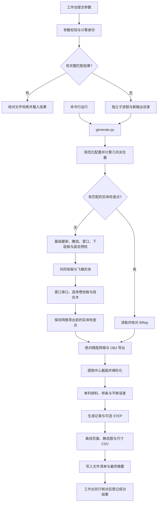

# 程序执行过程（v0.3）

本篇说明当前生成器如何把参数转换为三维构件、立脚飞椽排料和离线查看页，按 2026-10-29 的源码核对。几何定义、公式与近似方法见配套的[生成原理与计算公式](生成原理与计算公式.md)；完整输入表见[参数说明](../参数说明.md)。

面向古建筑学习者的讲解见[从书中做法到生成公式](从书中做法到生成公式.md)，可先了解书图知识如何转成几何关系，再阅读本篇的程序流程。

工作台和命令行最终都调用 `generate.py`。`engine/stage02_core.py` 至 `stage05_core.py` 是本生成器携带的计算模块，阶段编号表示构造依赖；运行时在内存中依次组装构件，不要求先去运行研究目录中的旧脚本或读取旧模型。

## 1. 总体执行链



图中的“载入完整结果”和“恢复实体检查点”是两个分支。前者直接复用交付物；后者仅跳过 CAD 实体重建，仍重新导出网格、提取截面和计算排料。命令行完成后直接返回摘要，只有通过工作台提交的任务进入登记环节。

## 2. 入口与模块职责

以下路径均相对于生成器目录 `生成器/直角戗角/`。

| 入口或模块 | 主要职责 |
| --- | --- |
| [start_ui.ps1](../start_ui.ps1)、[启动界面.cmd](../启动界面.cmd) | 启动或复用本项目的本机工作台，默认端口 8765 |
| [workbench_server.py](../workbench_server.py) | 解析端口参数，启动 HTTP 服务 |
| [workbench_backend.py](../workbench_backend.py) | 配置快速校验、计算身份、缓存、子进程、任务记录及结果登记 |
| [ui/app.js](../ui/app.js) | 编辑草稿、提交任务、轮询状态、切换当前显示结果 |
| [run.ps1](../run.ps1)、[generate.py](../generate.py) | 命令行入口及完整计算流程 |
| [engine/config.py](../engine/config.py) | 接受字段、补齐参数默认值、数值和组合关系检查 |
| [engine/stage02_core.py](../engine/stage02_core.py) | 坐标骨架、桁、戗山木、老戗、出檐椽与摔网分档 |
| [engine/stage03_core.py](../engine/stage03_core.py) | 嫩戗、弯里口木与下层望板 |
| [engine/stage04_core.py](../engine/stage04_core.py) | 板面采样、投影关系、立脚与正身飞椽姿态预检 |
| [engine/stage05_core.py](../engine/stage05_core.py) | 共同母板、贴板尖尾飞椽、里口承口、连续卷戗板与组合木 |
| [render_delivery.py](../render_delivery.py) | 将已算数据转成离线网页、静态图和尺寸表 |

## 3. 参数进入程序后如何处理

配置的顶层只接受 `case_id`、`corner_angle_deg`、`parameters`、`advanced`。`parameters` 和 `advanced` 内部允许省略已知字段，由代码补齐默认值；未知字段报错。当前 `corner_angle_deg` 必须在 JSON 中显式提供，90°是默认配置和界面的初始值，不表示缺省字段会被接受。

`config.resolve_config()` 检查有限数值、正值、比例范围及组合约束。例如建筑内角须满足 `0 < corner_angle_deg < 180`，嫩戗满足 `0 < U_n < L_n`，若干采样数须为奇数，以保留中心截面。具体范围以[参数说明](../参数说明.md)和该函数为准。

之后，`derived_geometry_values()` 调用 `stage02.load_case()` 和 `setup_fan_surface()`，在不建 BRep 实体的情况下重新计算控制弧、奇数分档数及嫩戗车背矢高。`update_resolved_geometry_derivations()` 写入 `fan_division_count_n`、`fan_count`、弧长间距及矢高等派生值，供后续构造与恢复身份比较使用。

这里区分三层数据：

| 数据 | 内容与用途 |
| --- | --- |
| 输入 JSON | 用户给定的案例名、角度、主参数和高级参数 |
| 规范化配置 | 已补齐默认值并通过输入检查的配置 |
| `parameters_resolved.json` | 本次实际配置与重算后的 `derived`，记录实际构造依据 |

输入合法只说明快速检查通过。极端角度、过宽构件或不成立的接触关系，仍可能在姿态求解、实体构造或导出阶段失败。

## 4. 从基础构件到完整实体

无可用检查点时，`generate()` 按以下顺序执行；各步在同一子进程内共享上下文 `ctx`。

1. **建立基础与预检。** `stage05.build_stage04_base()` 调用 `stage04.build_base_and_preflight()`。后者先由 `stage02.make_parts()` 建立桁、戗山木、老戗、出檐椽和摔网椽，再调用 stage03 建立嫩戗、两侧里口和下层板。随后把下层板与里口三角化为采样面，计算飞椽的投影、支承和姿态。预检结果必须包含当前分档应有的全部立脚飞椽；失败或缺根时明确终止，不静默跳过。
2. **生成飞椽实体。** `stage05.add_contact_flyers()` 先为立脚飞椽建立覆盖整翼的共同母板，再由各椽带域取得构件；同时生成正身飞椽。边界普通飞椽单独保留。侧面边界、触板尖尾和实际厚度关系详见原理篇。
3. **重切里口承口。** `stage05.cut_contact_likou_notches()` 使用与立脚飞椽相同的带域和母板底面构造槽刀，再完成两翼承口及镜像关系。不能把预检用的里口采样面当作最终开槽后的形状。
4. **重建上层卷戗板。** `stage05.add_upper_rollboards()` 依据实际飞椽顶面、椽间控制点和边界普通飞椽承托关系，形成每翼一件的连续板，并按当前角度裁定边界。
5. **重建组合木。** `stage05.add_combination()` 建立菱角木、扁担木相关组合料坯，并按老戗、嫩戗等实际几何切削。
6. **保存导出前检查点。** `save_geometry_checkpoint()` 在 `geometry_checkpoint/` 内写出各构件 BRep、几何记录、配置与源码身份，供网格导出失败后恢复。

`ctx` 的主要内容是 `parts`（构件实体及编号）、`control`（控制线）、`case`（几何参数），以及采样面和飞椽、承口、板等构造记录。它是本次计算的内存对象，最终按各类输出文件保存，不能用旧网格替换其中的几何来源。

## 5. 导出、截面、排料与展示

### 网格与 OBJ

`export_mesh()` 对构件调用 `absolute_face_mesh()`：清理旧三角化缓存，以毫米绝对偏差重新划分网格，并逐面检查三角网、索引、偏差和边界离散要求。若默认目标不够，按请求值的 `1、1/2、1/4、1/8、1/16、1/32` 有界细化；验收仍以原请求上限为准。

网格写入 `model_mesh.json` 和 `model.obj`，逐面诊断写入 `mesh_export_diagnostics.json`。全部网格导出成功后，清理**当前输出目录**中的 `geometry_checkpoint/`；从其他失败结果恢复时，不因此删除来源目录的检查点。

### 截面与单列排料

`make_profiles()` 只提取本次单侧立脚飞椽的 `v=0` 中心纤维，按当前排料定义整理为梯形，保存到 `profiles.json`，并写入来源网格的 SHA-256。每个模板通过 `model_ids` 对应模型两翼的实际构件。

`make_layout()` 将梯形刚体变换到 A 点共底线、AD/BC 竖直的位置，依次排成一列；计算 b/c/d 自然三次样条、c/d 平移近似误差、板材尺寸和面积利用率。`layout.json` 的板厚取 `parameters.w_fly`，输出明确为一侧模板、制作两套。正身飞椽不进入这份排料。

### 生成记录与离线页面

`generation_record()` 写入本次构件、模板、网格与阶段信息。指定 `--step` 时，正常生成流程另外导出 STEP；当前不做 STEP 回读验证。

默认调用 `render_delivery.render_case()`：读取网格和排料 JSON，把数据嵌入三维与排料 HTML，复制本地运行资源，生成 PNG/SVG 和 `marking_points.csv`，再写出 `delivery.json`。显示阶段不重建 CAD，也不重新进行实体接触验收。

正常生成的最后一步更新 `validation.json` 的阶段耗时与渲染结果，再由 `build_manifest()` 为目录内除清单自身以外的文件记录路径、大小与 SHA-256。命令行最后一行输出 JSON 摘要，包含目录、构件数、模板数、板材尺寸、利用率、误差和耗时。

## 6. 工作台如何调度同一条计算链

1. 启动脚本先通过 `GET /api/bootstrap` 检查应用 ID、工作区和版本；相符则复用服务，否则另行启动并等待就绪。服务仅监听 `127.0.0.1`。状态目录锁限制同一工作台只运行一个后台服务实例。
2. 前端校验按钮调用 `POST /api/validate`，得到规范化参数、快速派生量和计算 key，不启动完整 CAD。
3. 点击更新后调用 `POST /api/jobs`。后台先查完整结果缓存；命中且文件核对通过时，返回已经成功的复用任务，不再启动子进程。
4. 未命中时，若已有运行任务则返回 409；否则分配新的任务 ID 和 `outputs/workbench/case-…/` 目录，保存任务配置，通过独立 Python 子进程运行 `generate.py`。同一服务同时最多一个 CAD 生成任务。
5. 后台从子进程日志映射实际阶段。前端约每 2 秒查询 `GET /api/jobs/<id>`，展示阶段和耗时，不推算虚假的完成百分比。关闭网页不会终止子进程。
6. 子进程退出成功后，后台还会重新核对源码指纹、清单文件哈希、配置及网格角度、分档数 `n` 与 `n−1` 模板数、模板和模型编号关系。只有这些条件满足，才加入历史并标记 `succeeded`。
7. 成功任务自动载入结果；失败或取消时，界面保留此前成功结果。重新打开页面可以继续观察任务。服务重启时，遗留的排队或运行记录标为 `interrupted`，不自动重启 CAD。

任务状态为 `queued → running → succeeded/failed/cancelled/interrupted`；缓存命中可直接得到 `succeeded`。取消接口为 `POST /api/jobs/<id>/cancel`，取消请求与子进程实际退出之间可能有短暂间隔。完整协议见[工作台接口与验收约定](../WORKBENCH_CONTRACT.md)。

### 计算身份

完整结果缓存的 key 由以下数据的稳定 JSON 表示取 SHA-256：

```text
{
  config: {corner_angle_deg, parameters, advanced},
  source_fingerprint: 当前生成核心源码指纹
}
```

`case_id` 是显示名称，不参与这一 key；因此相同配置改名可以复用，但界面会显示实际载入结果的名称。角度、主参数和高级参数均参与身份。核心指纹覆盖引擎 Python、生成入口、参数 schema、渲染器、查看器及排料脚本和模板等，实际文件集合由 `core_source_files()` 定义。

草稿和当前显示结果分别保存。编辑参数、载入参数示例、校验成功，都不会自行更新模型；“查看此结果”会载入该历史结果并回填其参数，也不启动计算。导出链接跟随当前显示结果。

## 7. 生成目录里的文件

| 文件或目录 | 产生阶段与用途 |
| --- | --- |
| `parameters_resolved.json` | 输入校验及派生量更新后写入，记录实际参数 |
| `geometry_checkpoint/` | 实体完成、网格导出前的恢复数据；正常网格导出成功后清理本次目录中的检查点 |
| `model_mesh.json`、`model.obj` | 分构件三角网及 OBJ |
| `mesh_export_diagnostics.json` | 网格划分、细化、逐面检查与失败构件信息 |
| `profiles.json` | 中心截面梯形、模板及两翼构件编号、来源网格哈希 |
| `layout.json` | 排料位置、样条系数、平移误差与板材统计 |
| `validation.json` | 生成记录、构造细节、检查范围、阶段耗时及视觉待办状态 |
| `model.step` | 指定 `--step` 时的额外实体导出 |
| `model.html`、`layout.html`、`index.html` | 三维查看器、排料页与结果入口 |
| `layout.png`、`layout.svg`、`model_preview.png` | 静态图 |
| `marking_points.csv` | 竖线累计坐标、A/B/C/D 纵坐标及制作套数 |
| `delivery.json` | 展示文件、来源数据哈希和展示范围 |
| `manifest.json` | 输出文件清单及完整性核对依据 |

使用 `--no-render` 时不生成 HTML、PNG/SVG、CSV 等展示产物；保留核心计算数据。这样的目录不能直接满足工作台完整结果登记的文件要求。

## 8. 运行与查看日志

以下命令均在生成器目录执行。示例输出名应换成尚未使用的独立目录；正常命令行生成允许写入已有输出目录，因此不要把示例指向已登记的历史结果。

```powershell
Set-Location 'C:\Users\24408\Documents\ChatGPT\木构造\生成器\直角戗角'

# 启动本机工作台
.\start_ui.ps1

# 从配置生成一份独立结果
.\run.ps1 -Config configs/default.json -Output outputs/docs_example
```

直接运行 Python 时：

```powershell
$py = Join-Path $env:USERPROFILE '.cache/codex-runtimes/codex-primary-runtime/dependencies/python/python.exe'
& $py -X utf8 -u generate.py --config configs/default.json --output outputs/docs_example_data --no-render
```

`run.ps1` 优先使用上面的项目运行时，找不到时尝试 PATH 中的 Python；`start_ui.ps1` 要求该项目运行时存在。引擎依赖来自项目的 `资料整理/tmp/model_deps`、`资料整理/tmp/section_plot_deps`，包括 CadQuery/OCP、NumPy、SciPy、Matplotlib；离线查看器资源在 `vendor/`，详见[使用说明](../README.md)。

独立 CLI 的控制台会输出 `generator:`、`stage04:`、`stage05:` 阶段日志；工作台服务日志在 `ui_state/server.stdout.log`、`server.stderr.log`，任务状态和日志尾部另存于 `ui_state/workbench_state.json`。分阶段耗时主要看正常生成结果中的 `validation.json → phase_timings_seconds`；性能实例见[生成速度说明](../PERFORMANCE.md)。

生成入口捕获到异常时，CLI 以退出码 2 结束并打印错误；但正常生成流程中的 `render_case()` 渲染异常会被记录为 `render.available=false`，核心数据保留，不能单凭进程退出码认定展示文件完整。工作台还会执行第 6 节的文件检查，缺少必需文件时不会登记成功。

## 9. 中断后如何继续

先按已保存的产物判断中断阶段，不把不同恢复方式混用。

| 已有状态 | 继续方式 | 实际重做内容 |
| --- | --- | --- |
| 完整、已登记的成功结果 | 从历史查看，或提交相同配置命中缓存 | 核对后复用全部交付物 |
| 实体完成，网格失败，保留 `geometry_checkpoint/` | 工作台正常再提交；程序自动寻找相符检查点 | 读取 BRep，再导出网格、截面、排料与页面 |
| 网格、OBJ、截面、排料、参数均已存在，最后收尾中断 | 对自己的独立输出使用 `--finalize-existing` | 核对已有文件关系，补写生成记录、展示和清单 |
| 核心数据完整，只需重新制作展示 | 对自己的独立输出运行 `render_delivery.py` | 仅重制页面、图与 CSV，不重算几何或排料 |

实体检查点恢复要求规范化角度、主参数、高级参数、重算的 `derived` 与几何源码身份一致，并核对 BRep 清单、文件哈希、非空读取及恢复体积。案例名称可以变化。网格精度参数也参与内部板面采样，属于几何输入，不能在恢复时随意修改。检查点保存完整生产源码身份供追溯，恢复判断另用几何源码身份，因此显示或导出实现的修复可以与重新建实体分开。

搜索范围是当前输出目录的检查点和工作台 `outputs/workbench/case-*/geometry_checkpoint/`；它不是任意目录扫描。匹配的检查点损坏时会报错，不能将其当作有效恢复来源。

收尾恢复的命令示例：

```powershell
# 前提：该目录原来就由这一份配置生成
& $py -X utf8 generate.py --config configs/default.json --output outputs/docs_example --finalize-existing

# 仅重新制作独立 CLI 结果的展示文件
& $py -X utf8 render_delivery.py outputs/docs_example
```

`--finalize-existing` 必须核对案例名、角度、主参数和高级参数，检查模板对应的模型编号、来源网格哈希及当前分档根数。它不重新构造实体，也不能把缺根或另一份参数的输出补成正确模型；当前收尾实现会移除已有 `model.step`，不负责补导出 STEP。

单独运行 `render_delivery.py` 不更新 `manifest.json`。已经登记的结果按文件哈希保持身份，不应原地重制；应通过工作台产生新的结果。修改源码或模型参数后，也不能靠更改旧记录将历史输出当作当前生成物。

## 10. 如何解读“完成”

需要分别查看以下证据，避免把不同层级的状态当作同一种验收：

| 状态或证据 | 实际含义 |
| --- | --- |
| `/api/validate` 的 `valid=true` | 输入和快速几何派生通过；未建完整实体 |
| 构造中的实体守卫、逐面网格诊断 | 对应实体或导出步骤的局部计算条件满足 |
| `validation.passed=true` | 当前流程的交付生成完成标记；其 `assessment_basis` 为生成完成、视觉待检查 |
| 工作台 `succeeded`、案例 `validated=true` | 生成子进程完成，且配置、清单和模型/排料关系满足登记条件 |
| `visual_review.status` 和[视觉验收记录](../VISUAL_ACCEPTANCE.md) | 另行进行的实际模型外形观察及其范围 |

当前生成记录明确写有 `model_geometry_checks_run=false`，未执行全构件两两碰撞验收。排料是中心截面梯形近似，没有全宽曲面展开；样条平移误差只报告，不用作模型生成通过阈值。物理承载、实物加工及历史工法的符合性，需要各自的验证依据，不能由上述完成标记推导。
